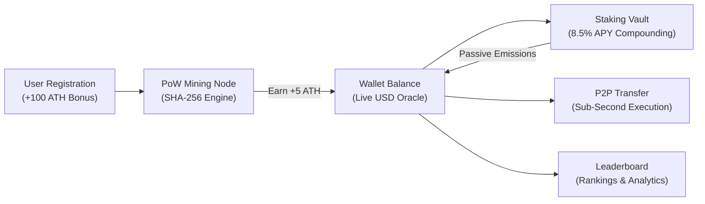

<p align="center">
  
</p>

<h1 align="center">AETHERIUM PROTOCOL ($ATH)</h1>

<p align="center">
  <b>Full-Stack Simulated Cryptocurrency Ecosystem & Proof-of-Work Mining Engine</b>
</p>

<p align="center">
  <a href="#"></a>
  <a href="#"></a>
  <a href="#"></a>
  <a href="#"></a>
</p>

---

```
  █████╗ ███████╗████████╗██╗  ██╗███████╗██████╗ ██╗██╗   ██╗███╗   ███╗
 ██╔══██╗██╔════╝╚══██╔══╝██║  ██║██╔════╝██╔══██╗██║██║   ██║████╗ ████║
 ███████║█████╗     ██║   ███████║█████╗  ██████╔╝██║██║   ██║██╔████╔██║
 ██╔══██║██╔══╝     ██║   ██╔══██║██╔══╝  ██╔══██╗██║██║   ██║██║╚██╔╝██║
 ██║  ██║███████╗   ██║   ██║  ██║███████╗██║  ██║██║╚██████╔╝██║ ╚═╝ ██║
 ╚═╝  ╚═╝╚══════╝   ╚═╝   ╚═╝  ╚═╝╚══════╝╚═╝  ╚═╝╚═╝ ╚═════╝ ╚═╝     ╚═╝
```

---

## Overview

**Aetherium ($ATH)** is a modern cryptocurrency simulation platform designed with a high-end Web3 interface, real-time hardware telemetry HUDs, live WebSocket price oracles, automated liquidity staking, and an auditable blockchain ledger.

---

## Architectural Workflow



---

## Core System Modules

| Module | Architecture & Protocol | Interface & Graphics |
| :--- | :--- | :--- |
| **Proof-of-Work Mining Engine** | Cryptographic nonce verification matching leading-zero difficulty (`0000*`) via SHA-256 hashing. | Hardware telemetry HUD displaying real-time hashrate (**84.21 GH/s**), core thermal tracking, and candidate hash stream. |
| **Real-Time Price Oracle** | WebSocket streaming engine broadcasting periodic market variations with supply/demand drift. | Chart.js glowing area chart with custom dark tooltips and volume trends. |
| **Liquidity Staking Vault** | Automated yield contract with lock/unlock state handling. | Interactive tab controls with live 8.5% APY compounding metrics. |
| **P2P Transfer Network** | Direct client-to-client transaction settlement with zero network fees. | Streamlined transfer modal supporting usernames and `0x...` hex wallet addresses. |
| **Audit Ledger** | Permanent transaction indexing linked by unique cryptographic transaction hashes. | Multi-tier filterable data table with status badges and timestamping. |
| **Rankings Leaderboard** | Real-time database query sorting by total balances and staking allocations. | Ranking table with custom tier badges and wallet address masking. |

---

## Visual Design System

- **Glassmorphism:** Multi-layered frosted glass panels (`backdrop-filter: blur(28px)`) with subtle gradient borders.
- **Color Palette:** Deep space backgrounds (`#030712`, `#080c1d`) with high-contrast `#a855f7` (Violet) and `#06b6d4` (Cyan) accents.
- **Typography:** *Outfit* for clean UI readability and *JetBrains Mono* for cryptographic data and numbers.

---

## Directory Structure

```
Aetherium-Simulation/
│
├── client/                          # React 18 Web3 Frontend
│   ├── public/                      # Static assets & html entrypoint
│   └── src/
│       ├── components/
│       │   ├── Navbar.js            # Header navigation & live price ticker
│       │   ├── Dashboard.js         # Central hub & live market chart
│       │   ├── MineCoin.js          # Interactive PoW node & telemetry HUD
│       │   ├── BuyCoin.js           # Instant fiat-to-token gateway
│       │   ├── TransferCoin.js      # Zero-fee P2P wallet transfers
│       │   ├── StakingVault.js      # 8.5% APY liquidity vault
│       │   ├── TransactionHistory.js # Auditable blockchain transaction ledger
│       │   ├── Leaderboard.js       # Top holders ranking matrix
│       │   └── Login.js / Signup.js # User authentication
│       ├── context/
│       │   └── AuthContext.js       # Authentication state & WebSocket listener
│       ├── index.css                # CSS design system & animations
│       ├── App.js                   # Routing & protected routes
│       └── index.js                 # DOM entrypoint
│
└── server/                          # Node.js + Express + Socket.io Backend
    ├── models/                      # User & Transaction Mongoose schemas
    ├── routes/                      # REST endpoints for Auth, Wallet, and Ledger
    ├── middleware/                  # JWT authentication middleware
    ├── server.js                    # Express server & Market Simulation Engine
    ├── package.json                 # Backend dependencies
    └── .env.example                 # Configuration template
```

---

## Getting Started

### Prerequisites
- **Node.js** (v18.0.0 or higher)
- **MongoDB** (Local instance or MongoDB Atlas connection string)

### 1. Start Backend Server
```bash
cd server
npm install
node server.js
```
*Server starts on `http://localhost:5000` with WebSocket support enabled.*

### 2. Start Frontend Application
```bash
cd ../client
npm install
npm start
```
*Client application launches on `http://localhost:3000`.*
